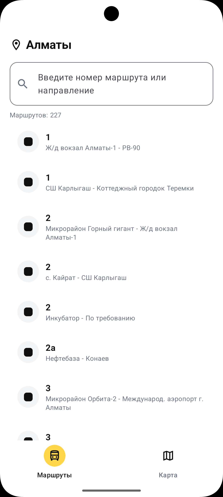
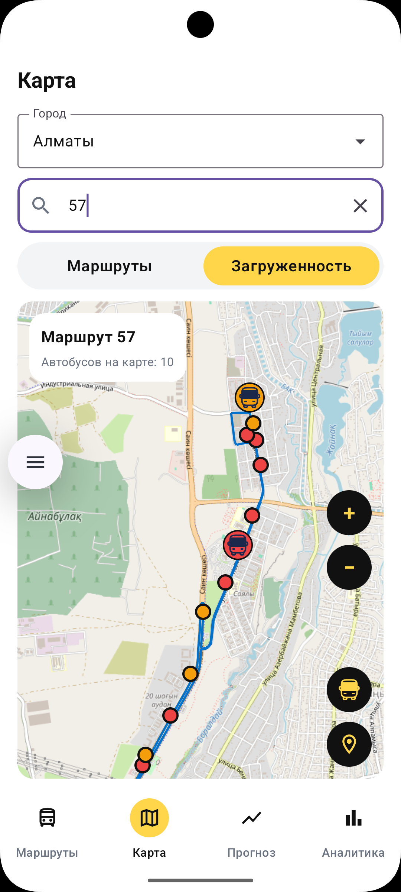
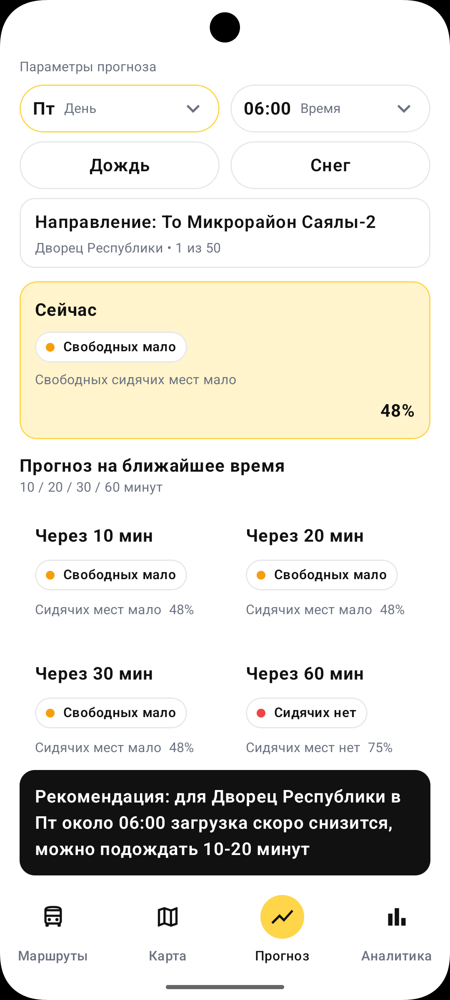
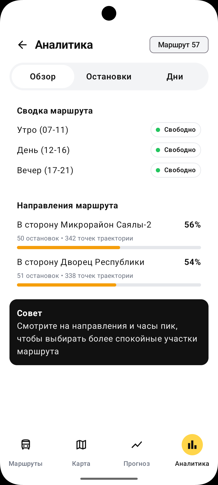

<div align="center">
  <h1>QalaBus</h1>
  <p><a href="README.md">English</a> · <a href="README.ru.md">Русский</a> · <strong>Қазақша</strong></p>
</div>

<div align="center">
  <a href="#мүмкіндіктер">Мүмкіндіктер</a> · <a href="#скриншоттар">Скриншоттар</a> · <a href="#backend-серверін-іске-қосу">Backend</a> · <a href="#android-қолданбасын-жинау">Құрастыру</a> · <a href="#api">API</a> · <a href="#модельді-қайта-оқыту">Модель</a> · <a href="#жоба-құрылымы">Құрылымы</a> · <a href="#дереккөздер">Деректер</a>
</div>

QalaBus Алматы жолаушыларына автобус бағыттарын қарап, сапар кезінде автобустың қаншалықты толы болуы мүмкін екенін алдын ала бағалауға көмектеседі. Картадан маршрут пен аялдамаларды көруге болады, ал болжам уақытты, апта күнін және ауа райын ескеріп, жолға шығуға ыңғайлы сәтті таңдауға көмектеседі.

## Мүмкіндіктер

Қосымшада маршруттарды іздеу, карта, таңдалған аялдамадағы жолаушы тығыздығын 10, 20, 30 және 60 минутқа болжау, сондай-ақ маршрут аналитикасы бар.

Әзірге болжам синтетикалық деректерге негізделген, ал картадағы автобустардың қозғалысы демонстрациялық режимде көрсетіледі.

## Скриншоттар

<table>
  <tr>
    <td align="center"></td>
    <td align="center"></td>
    <td align="center"></td>
    <td align="center"></td>
  </tr>
</table>

## Backend серверін іске қосу

Python 3.10 немесе одан кейінгі нұсқа қажет. PowerShell терминалын `backend` бумасында ашыңыз:

```powershell
python -m venv .venv
.\.venv\Scripts\Activate.ps1
python -m pip install -r requirements.txt
.\start_backend_dev.ps1
```

API http://127.0.0.1:8000 мекенжайында қолжетімді болады. API құжаттамасы — http://127.0.0.1:8000/docs, сервер күйін тексеру — http://127.0.0.1:8000/health.

Автоматты қайта жүктеусіз іске қосу үшін `backend` бумасынан `start_backend.ps1` скриптін орындаңыз. Алғашқы іске қосылғанда сервер `backend/data/transport.sqlite3` SQLite дерекқорын жасап, оған маршруттар мен аялдамалар деректерін жүктейді.

### Android қолданбасын backend серверіне қосу

`BackendServerConfig.baseUrl` мекенжайын `app/src/main/java/com/example/busoccupancypredictor/data/BackendForecastRepository.kt` файлынан баптаңыз.

- Android Studio эмуляторы үшін `http://10.0.2.2:8000/` мекенжайын қолданыңыз.
- Нақты телефонда компьютердің жергілікті IP мекенжайын көрсетіңіз, мысалы `http://192.168.1.10:8000/`. Телефон мен компьютер бір желіге қосылуы керек.

## Android қолданбасын жинау

Жобаны Android SDK орнатылған Android Studio бағдарламасында ашыңыз немесе репозиторийдің түбірлік бумасынан жинаңыз:

```powershell
./gradlew.bat assembleDebug
```

Дайын APK `app/build/outputs/apk/debug/app-debug.apk` жолында сақталады. Қосылған құрылғыға орнату үшін `./gradlew.bat installDebug` пәрменін орындаңыз.

Іске қосу экранында backend-пен жұмыс істеу үшін **«Бастау»**, ал жергілікті демонстрациялық деректерді көру үшін **«Жергілікті іске қосу»** нұсқасын таңдаңыз. Жергілікті режимде сервер қажет емес.

## API

Негізгі сұраулар:

- `GET /health` — сервер күйі.
- `GET /routes` — маршруттар тізімі.
- `GET /routes/{route_id}/stops` — маршруттың бағыттары мен аялдамалары.
- `POST /predict` — жолаушы тығыздығының болжамы.
- `GET /analytics/{route_id}?weather=clear` — маршрут аналитикасы.

Интерактивті құжаттама мен сұрау мысалдары Swagger UI жүйесінде `/docs` мекенжайында қолжетімді.

## Модельді қайта оқыту

Репозиторийдің түбірлік бумасынан мына пәрмендерді орындаңыз:

```powershell
cd backend
python -m venv .venv
.\.venv\Scripts\Activate.ps1
python -m pip install -r requirements.txt
python .\ml\generate_synthetic_dataset.py
python .\ml\train_catboost.py
```

Скрипттер CSV деректер жиынын және модельді `backend/data/` пен `backend/models/` бумаларына сақтайды. Деректер синтетикалық, ал генератор әдепкіде `42` seed мәнін қолданады. Жинақ өлшемі мен шығыс жолдарының параметрлерін көру үшін `--help` қолданыңыз.

Белгілер маңыздылығының CSV файлы мен графигін алу үшін `python .\ml\export_feature_importance.py` пәрменін орындаңыз. PNG графигін жасау үшін қосымша `matplotlib` орнату керек.

## Жоба құрылымы

- `app/` — Kotlin және Jetpack Compose негізіндегі Android қолданбасы.
- `backend/app/` — FastAPI, болжау, аналитика және SQLite дерекқорымен жұмыс.
- `backend/ml/` — синтетикалық деректер жиынын жасау және CatBoost моделін оқыту.
- `backend/models/` — оқытылған модель және оқу нәтижелері.
- `app/src/main/assets/` — Android қолданбасына енгізілген маршруттар мен аялдамалар деректері.
- `data/exports/` — дайындалған маршруттар мен аялдамалар экспорттары.

Қолданба `minSdk 24` нұсқасын қолдайды. Жобада Android Gradle Plugin 9.1.0 және Kotlin 2.2.10 қолданылады.

## Дереккөздер

Жобаны жарияламас бұрын 2GIS деректері мен OpenStreetMap тайлдарын пайдалану шарттарын тексеріп, қажетті атрибуцияны қосыңыз. Қазір репозиторийде жоба лицензиясы көрсетілмеген.
