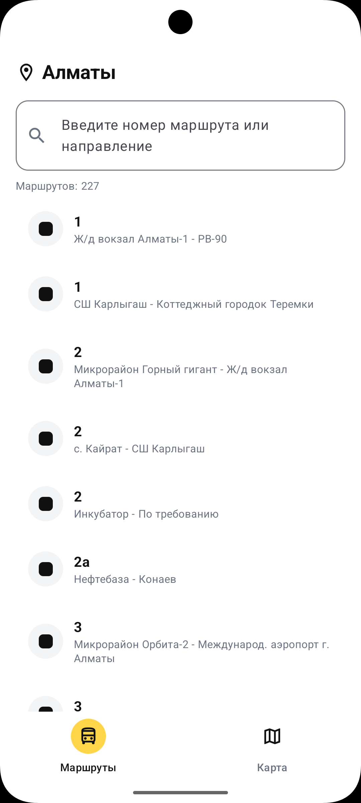
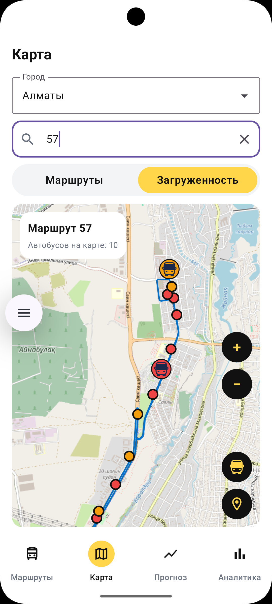
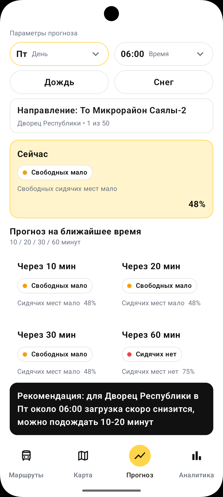

# QalaBus

Я делаю QalaBus как дипломный проект: Android-приложение, в котором можно посмотреть автобусные маршруты Алматы и оценить загруженность на остановках. Это прототип, поэтому здесь есть и настоящие компоненты системы, и демонстрационные данные.

Сейчас в приложении можно найти маршрут, посмотреть его на карте, выбрать остановку и получить прогноз на 10, 20, 30 или 60 минут. Прогноз учитывает день недели, время и погоду. Есть отдельный экран аналитики.

## Что важно знать о прогнозе

Модель CatBoost обучена на синтетических данных. У меня нет реальных измерений пассажиропотока, поэтому цифры в приложении пока нужны для демонстрации работы системы, а не для планирования поездки. Если модель недоступна или не может посчитать прогноз, backend использует запасную эвристику.

Автобусы на карте тоже не отслеживаются в реальном времени: их движение симулируется. Сами маршруты и остановки загружены в проект из подготовленных данных 2GIS.

## Запустить backend

Нужен Python 3.10 или новее. В PowerShell откройте терминал в папке `backend`:

```powershell
python -m venv .venv
.\.venv\Scripts\Activate.ps1
python -m pip install -r requirements.txt
.\start_backend_dev.ps1
```

Для обычного запуска без autoreload запустите скрипт start_backend.ps1 из папки backend.

При первом старте сервер создаст SQLite-базу в `backend/data/transport.sqlite3` и заполнит её данными маршрутов и остановок.

### Подключить Android к серверу

Адрес задаётся в `BackendServerConfig.baseUrl` в файле `app/src/main/java/com/example/busoccupancypredictor/data/BackendForecastRepository.kt`.

- В эмуляторе Android Studio оставьте `http://10.0.2.2:8000/`.
- На телефоне укажите локальный IP компьютера, например `http://192.168.1.10:8000/`. Телефон и компьютер должны быть в одной сети.

## Собрать приложение

Откройте проект в Android Studio с установленным Android SDK или соберите его из корня репозитория:

```powershell
./gradlew.bat assembleDebug
```

Готовый APK будет в `app/build/outputs/apk/debug/app-debug.apk`. Для установки на подключённое устройство можно выполнить `./gradlew.bat installDebug`.

На стартовом экране выберите «Начать», чтобы использовать backend, или «Запуск локально», чтобы посмотреть приложение с локальными демонстрационными данными. В локальном режиме сервер не нужен.

## Как выглядит приложение

<table>
  <tr>
    <td align="center"></td>
    <td align="center"></td>
    <td align="center"></td>
    <td align="center"></td>
  </tr>
</table>

## API

Основные запросы:

- `GET /health` — состояние сервера.
- `GET /routes` — список маршрутов.
- `GET /routes/{route_id}/stops` — остановки и направления маршрута.
- `POST /predict` — прогноз загруженности.
- `GET /analytics/{route_id}?weather=clear` — аналитика маршрута.

Интерактивная документация и пример тела запроса доступны в Swagger UI по адресу `/docs`.

## Переобучить модель

Из корня проекта выполните:

```powershell
cd backend
python -m venv .venv
.\.venv\Scripts\Activate.ps1
python -m pip install -r requirements.txt
python .\ml\generate_synthetic_dataset.py
python .\ml\train_catboost.py
```

Скрипты создадут CSV-датасет и модель в папках `backend/data/` и `backend/models/`. Датасет синтетический; генератор по умолчанию использует seed `42`. Параметры генерации и пути можно посмотреть через `--help`.

Чтобы получить CSV и график важности признаков, запустите `python .\ml\export_feature_importance.py`. Для PNG потребуется дополнительно установить `matplotlib`.

## Где что лежит

- `app/` — Android-клиент на Kotlin и Jetpack Compose.
- `backend/app/` — FastAPI, прогнозирование, аналитика и работа с SQLite.
- `backend/ml/` — генерация обучающего набора и обучение CatBoost.
- `backend/models/` — модель и результаты её обучения.
- `app/src/main/assets/` — данные маршрутов и остановок для приложения.
- `data/exports/` — подготовленные выгрузки маршрутов и остановок.

Клиент настроен на Android с `minSdk 24`; проект использует Android Gradle Plugin 9.1.0 и Kotlin 2.2.10.

## Источники данных

Перед публикацией проекта проверьте условия использования данных 2GIS и тайлов OpenStreetMap и добавьте нужную атрибуцию. Отдельная лицензия проекта пока не добавлена.
