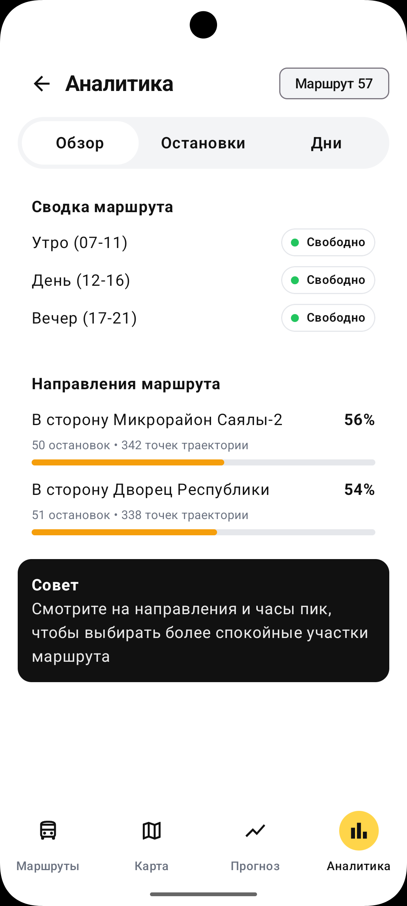

<div align="center">
  <h1>QalaBus</h1>
  <p><strong>English</strong> · <a href="README.ru.md">Русский</a> · <a href="README.kk.md">Қазақша</a></p>
</div>

<div align="center">
  <a href="#features">Features</a> · <a href="#screenshots">Screenshots</a> · <a href="#run-the-backend">Backend</a> · <a href="#build-the-android-app">Build</a> · <a href="#api">API</a> · <a href="#retrain-the-model">Model</a> · <a href="#project-structure">Structure</a> · <a href="#data-sources">Data</a>
</div>

QalaBus helps passengers explore bus routes and estimate how crowded a trip may be. The map shows routes and stops, while the forecast lets passengers compare different times, weekdays, and weather conditions to help choose a more convenient time to travel.

## Features

The app includes route search, a map, stop-level occupancy forecasts for 10, 20, 30, and 60 minutes ahead, and route analytics.

The forecast currently uses synthetic data, and bus movement on the map is shown in a demo mode.

## Screenshots

<table>
  <tr>
    <td align="center"></td>
    <td align="center"></td>
    <td align="center"></td>
    <td align="center"></td>
  </tr>
</table>

## Run the backend

Python 3.10 or newer is required. Open PowerShell in the `backend` directory:

```powershell
python -m venv .venv
.\.venv\Scripts\Activate.ps1
python -m pip install -r requirements.txt
.\start_backend_dev.ps1
```

The API will be available at http://127.0.0.1:8000. Browse the interactive API docs at http://127.0.0.1:8000/docs or check the server health at http://127.0.0.1:8000/health.

To run without autoreload, start `start_backend.ps1` from the `backend` directory. On its first run, the backend creates `backend/data/transport.sqlite3` and loads the route and stop data into SQLite.

### Connect the Android app to the backend

Set `BackendServerConfig.baseUrl` in `app/src/main/java/com/example/busoccupancypredictor/data/BackendForecastRepository.kt`.

- Android Studio emulator: use `http://10.0.2.2:8000/`.
- Physical device: use your computer's local IP address, for example `http://192.168.1.10:8000/`. The phone and computer must be on the same network.

## Build the Android app

Open the project in Android Studio with the Android SDK installed, or build it from the repository root:

```powershell
./gradlew.bat assembleDebug
```

The APK will be created at `app/build/outputs/apk/debug/app-debug.apk`. To install it on a connected device, run `./gradlew.bat installDebug`.

On the launch screen, choose the backend mode to connect to the server or local mode to explore the app with demo data. Local mode does not require the server.

## API

The main endpoints are:

- `GET /health` — server health.
- `GET /routes` — list of routes.
- `GET /routes/{route_id}/stops` — route directions and stops.
- `POST /predict` — occupancy forecast.
- `GET /analytics/{route_id}?weather=clear` — route analytics.

Interactive documentation and request examples are available in Swagger UI at `/docs`.

## Retrain the model

From the repository root, run:

```powershell
cd backend
python -m venv .venv
.\.venv\Scripts\Activate.ps1
python -m pip install -r requirements.txt
python .\ml\generate_synthetic_dataset.py
python .\ml\train_catboost.py
```

The scripts create the CSV dataset and model in `backend/data/` and `backend/models/`. The dataset is synthetic, and the generator uses seed `42` by default. Use `--help` to see options for dataset size and output paths.

To export feature importance as CSV and a chart, run `python .\ml\export_feature_importance.py`. The PNG chart additionally requires `matplotlib`.

## Project structure

- `app/` — Android client built with Kotlin and Jetpack Compose.
- `backend/app/` — FastAPI, forecasting, analytics, and SQLite storage.
- `backend/ml/` — synthetic dataset generation and CatBoost training.
- `backend/models/` — trained model and training artifacts.
- `app/src/main/assets/` — route and stop data bundled with the Android app.
- `data/exports/` — prepared route and stop exports.

The Android client supports `minSdk 24`. The project uses Android Gradle Plugin 9.1.0 and Kotlin 2.2.10.

## Data sources

Before publishing, check the terms for the 2GIS data and OpenStreetMap tiles and include any required attribution. This repository does not currently specify a project license.
