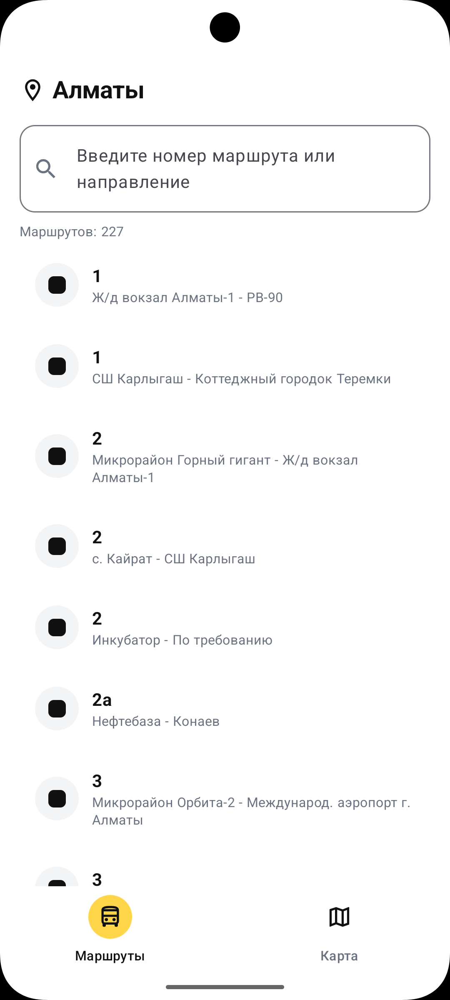
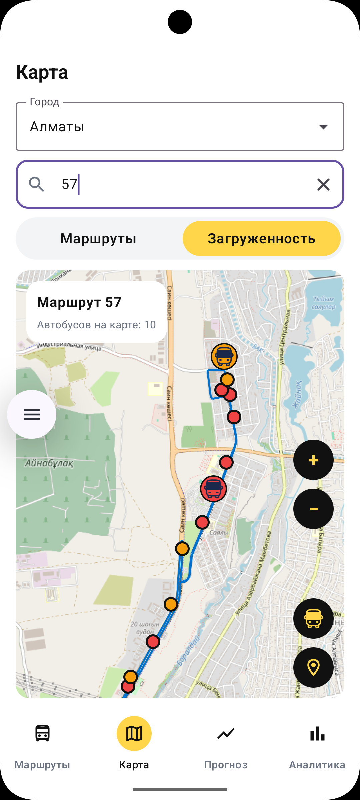
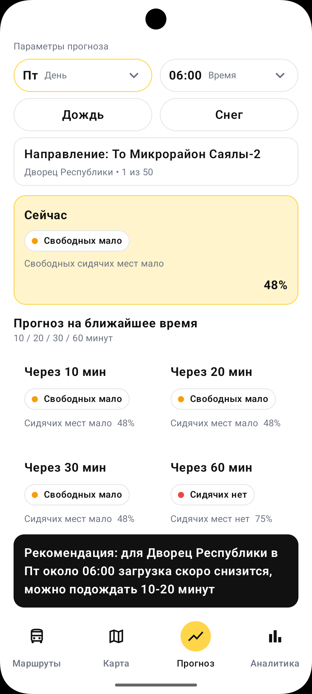
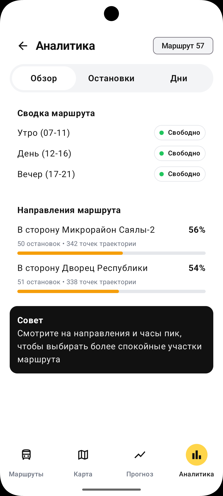

[English](README.md) · [Русский](README.ru.md) · [Қазақша](README.kk.md)

# QalaBus

QalaBus помогает пассажирам Алматы разобраться в автобусных маршрутах и заранее оценить, насколько загруженной может быть поездка. По карте можно посмотреть путь и остановки, а прогноз помогает сравнить варианты по времени, дню недели и погоде — чтобы выбрать более удобный момент для поездки.

В приложении есть поиск маршрутов, карта, прогноз загруженности на выбранной остановке на 10, 20, 30 и 60 минут, а также аналитика по маршруту.

Пока прогноз строится на синтетических данных, а движение автобусов на карте показано в демонстрационном режиме.

## Как выглядит приложение

<table>
  <tr>
    <td align="center"></td>
    <td align="center"></td>
    <td align="center"></td>
    <td align="center"></td>
  </tr>
</table>

## Запустить backend

Нужен Python 3.10 или новее. В PowerShell откройте терминал в папке `backend`:

```powershell
python -m venv .venv
.\.venv\Scripts\Activate.ps1
python -m pip install -r requirements.txt
.\start_backend_dev.ps1
```

API запустится на http://127.0.0.1:8000. Документация запросов находится на http://127.0.0.1:8000/docs, проверка работы сервера — http://127.0.0.1:8000/health.

Для обычного запуска без autoreload запустите `start_backend.ps1` из папки `backend`. При первом старте сервер создаст `backend/data/transport.sqlite3` и заполнит её данными маршрутов и остановок.

### Подключить Android к серверу

Адрес задаётся в `BackendServerConfig.baseUrl` в файле `app/src/main/java/com/example/busoccupancypredictor/data/BackendForecastRepository.kt`.

- В эмуляторе Android Studio используйте `http://10.0.2.2:8000/`.
- На телефоне укажите локальный IP компьютера, например `http://192.168.1.10:8000/`. Телефон и компьютер должны быть в одной сети.

## Собрать приложение

Откройте проект в Android Studio с установленным Android SDK или соберите его из корня репозитория:

```powershell
./gradlew.bat assembleDebug
```

APK появится в `app/build/outputs/apk/debug/app-debug.apk`. Для установки на подключённое устройство выполните `./gradlew.bat installDebug`.

На стартовом экране выберите **«Начать»**, чтобы использовать backend, или **«Запуск локально»**, чтобы посмотреть приложение с локальными демонстрационными данными. В локальном режиме сервер не нужен.

## API

Основные запросы:

- `GET /health` — состояние сервера.
- `GET /routes` — список маршрутов.
- `GET /routes/{route_id}/stops` — направления и остановки маршрута.
- `POST /predict` — прогноз загруженности.
- `GET /analytics/{route_id}?weather=clear` — аналитика маршрута.

Интерактивная документация и примеры запросов доступны в Swagger UI по адресу `/docs`.

## Переобучить модель

Из корня репозитория выполните:

```powershell
cd backend
python -m venv .venv
.\.venv\Scripts\Activate.ps1
python -m pip install -r requirements.txt
python .\ml\generate_synthetic_dataset.py
python .\ml\train_catboost.py
```

Скрипты создадут CSV-датасет и модель в папках `backend/data/` и `backend/models/`. Датасет синтетический; генератор по умолчанию использует seed `42`. Параметры генерации и пути вывода можно посмотреть через `--help`.

Чтобы получить CSV и график важности признаков, запустите `python .\ml\export_feature_importance.py`. Для PNG дополнительно потребуется `matplotlib`.

## Структура проекта

- `app/` — Android-клиент на Kotlin и Jetpack Compose.
- `backend/app/` — FastAPI, прогнозирование, аналитика и работа с SQLite.
- `backend/ml/` — генерация синтетического набора и обучение CatBoost.
- `backend/models/` — обученная модель и результаты обучения.
- `app/src/main/assets/` — данные маршрутов и остановок, включённые в приложение.
- `data/exports/` — подготовленные выгрузки маршрутов и остановок.

Приложение поддерживает `minSdk 24`; проект использует Android Gradle Plugin 9.1.0 и Kotlin 2.2.10.

## Источники данных

Перед публикацией проверьте условия использования данных 2GIS и тайлов OpenStreetMap и добавьте требуемую атрибуцию. Лицензия проекта в репозитории пока не указана.
